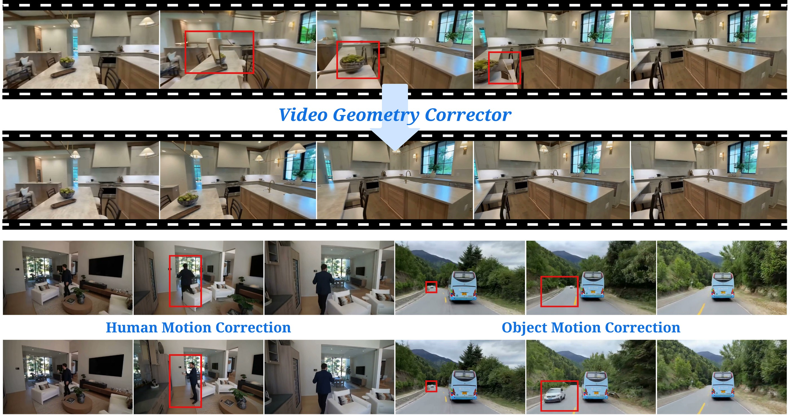

# Learning to Correct Geometry in Generated Videos

### 🦘 NeurIPS 2026 🍑

[Weijie Lyu](https://weijielyu.github.io/)<sup>1</sup>, [Tiancheng Shen](https://scholar.google.com/citations?user=iRY1YVoAAAAJ&hl=en)<sup>1</sup>, [Xiangtai Li](https://lxtgh.github.io/)<sup>2</sup>, [Yujing Wang](https://scholar.google.com/citations?user=YgL4rywAAAAJ&hl=en)<sup>3</sup>, [Xiaoyuan Wang](https://www.linkedin.com/in/xiaoyuan-isaac-wang/)<sup>4</sup>, [Haobo Yuan](https://yuanhaobo.me/)<sup>1</sup>, [Yizhou Zhao](https://yizhou42.github.io/)<sup>4</sup>, [Ming-Hsuan Yang](https://faculty.ucmerced.edu/mhyang/)<sup>1</sup>  
<sup>1</sup>UC Merced &nbsp;·&nbsp; <sup>2</sup>NTU &nbsp;·&nbsp; <sup>3</sup>PKU &nbsp;·&nbsp; <sup>4</sup>CMU

[&label=VGC&labelColor=%23f5f5dc&color=hsl(204%2C%2086%25%2C%2053%25))](https://weijielyu.github.io/VGC)
[](https://arxiv.org/abs/XXXX.XXXXX)

<div align='center'>

</div>

> *Video Geometry Corrector (VGC)* is a post-hoc video-to-video model that corrects geometry distortions in generated videos — warped structures, inconsistent parallax, drifting scene layouts — without modifying the source generator. Scaled to a larger backbone, it extends to general video refinement of dynamic human and object motion.

## 🔧 Prerequisites

### Environment Setup

```bash
conda create -n vgc python=3.11 -y
conda activate vgc

# Install PyTorch matching your CUDA, e.g.:
pip install torch torchvision --index-url https://download.pytorch.org/whl/cu128

# Install the dependencies (this also pulls the DiffSynth-Studio backbone)
pip install -e .

# Optional: flash-attention for faster inference (falls back to PyTorch SDPA otherwise)
pip install flash-attn --no-build-isolation
```

### Downloads

We release the Wan2.2 14B MoE model (720p, no optical flow).

**1. Base model weights** — [Wan2.2-I2V-A14B](https://huggingface.co/Wan-AI/Wan2.2-I2V-A14B) (~126 GB):

```bash
pip install huggingface_hub

hf download Wan-AI/Wan2.2-I2V-A14B \
  --include "high_noise_model/*" --include "low_noise_model/*" --include "Wan2.1_VAE.pth" \
  --include "models_t5_umt5-xxl-enc-bf16.pth" --include "configuration.json" --include "google/umt5-xxl/*" \
  --local-dir ./wan_models_cache/Wan2.2-I2V-A14B
```

**2. VGC checkpoints** from [Hugging Face](https://huggingface.co/wlyu/VGC):

```bash
hf download wlyu/VGC --local-dir ./checkpoints
```

**3. Captioning (optional)** — [Qwen3-VL](https://huggingface.co/Qwen/Qwen3-VL-32B-Instruct) captions the input videos:

```bash
hf download Qwen/Qwen3-VL-32B-Instruct --local-dir ./wan_models_cache/Qwen3-VL-32B-Instruct
```

Qwen3-VL is skipped when you provide the captions yourself (`--captions_json`). Any Qwen3-VL size
works via `--qwen_model`; the default 32B needs ~65 GB in bf16.

The expected layout:

```
wan_models_cache/
├── Wan2.2-I2V-A14B/
│   ├── high_noise_model/
│   ├── low_noise_model/
│   ├── Wan2.1_VAE.pth
│   ├── models_t5_umt5-xxl-enc-bf16.pth
│   └── google/umt5-xxl/
└── Qwen3-VL-32B-Instruct/

checkpoints/
└── wan22/
    ├── release_no_flow_high_noise.pth
    └── release_no_flow_low_noise.pth
```

## 🚀 Inference

VGC takes a geometry-distorted video and outputs a geometry-corrected one. Sample distorted
videos are provided in [`inputs/`](inputs/).

The model samples 81 frames uniformly from each input and outputs 720×1248, so it also performs
480p→720p super-resolution. It processes every `.mp4` in `--input_dir` and writes
`refined_<name>.mp4` to `--output_dir`.

**Single GPU**

```bash
python infer_vgc_wan22.py \
    --input_dir  inputs \
    --output_dir outputs
```

**Multi-GPU** — videos are distributed across GPUs:

```bash
torchrun --standalone --nproc_per_node 8 infer_vgc_wan22.py \
    --input_dir  inputs \
    --output_dir outputs
```

**Low-VRAM Mode** — one 14B expert at 720p needs ~80 GB. On GPUs with less memory (e.g. 48 GB),
keep the last DiT blocks on the CPU and move each to the GPU only for its own forward pass:

```bash
python infer_vgc_wan22.py \
    --input_dir  inputs \
    --output_dir outputs \
    --offload_blocks 12
```

This trades speed for memory; the results are the same.

**Available Arguments:**
| Argument | Default | Description |
|----------|---------|-------------|
| `--input_dir` | — | Directory of input distorted videos (`.mp4`) |
| `--output_dir` | — | Directory for corrected videos |
| `--captions_json` | Qwen3-VL | JSON of `{"<video name without .mp4>": "caption", ...}` |
| `--offload_blocks` | `0` | Number of DiT blocks kept on the CPU (Low-VRAM Mode) |
| `--num_inference_steps` | `50` | Number of denoising steps |
| `--seed` | `0` | Random seed |
| `--fps` | `15` | Output frame rate |

Captions generated by Qwen3-VL are cached in `<output_dir>/_captions.json`.

## 📝 Citation

If you find our work useful for your research, please consider citing our paper:

```bibtex
@inproceedings{lyu2026vgc,
  title     = {Learning to Correct Geometry in Generated Videos},
  author    = {Lyu, Weijie and Shen, Tiancheng and Li, Xiangtai and Wang, Yujing and
               Wang, Xiaoyuan and Yuan, Haobo and Zhao, Yizhou and Yang, Ming-Hsuan},
  booktitle = {Advances in Neural Information Processing Systems (NeurIPS)},
  year      = {2026}
}
```

## 📄 License

Codes are licensed under the [Apache-2.0 License](LICENSE).

## 🙏 Acknowledgements

This work is built upon [Wan](https://arxiv.org/abs/2503.20314) and [DiffSynth-Studio](https://github.com/modelscope/DiffSynth-Studio).
Captions use [Qwen3-VL](https://github.com/QwenLM/Qwen3-VL). We thank the authors for their excellent work.
